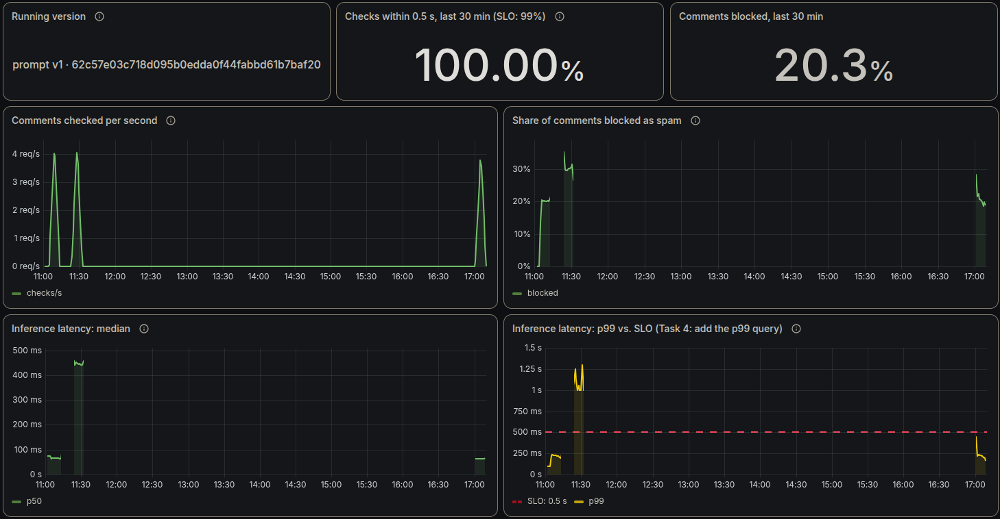

# Reflection

Name: Anapat

Service URL (`APP_URL`): https://spam-filter-dmxw.onrender.com

Dashboard screenshot during Task 4 (v1, then v2, then the rollback). Drag the image into this file on GitHub, or save it as `dashboard.png` next to this file:

Answer each question in 2–3 sentences.

**1. Which SLO could you check with the metrics from Task 1, and how? Name one more metric you would add to operate the spam filter, and the question it would answer.**

> The histogram spam_inference_seconds checks the latency SLO by giving the share of checks within 0.5 s (target 99%), and spam_detected_total divided by spam_requests_total checks the quality SLO by giving the share of comments blocked (target about 20%). This share does not show whether the right comments were blocked. I would add a counter of comments that users report as wrongly blocked to measure how many real comments the filter blocks.

**2. You created the service with Terraform once, but every new version was deployed by the pipeline. Why split the work this way? What did versioned images (one per commit) let you do in Task 4?**

> Terraform creates the parts that rarely change (service, metrics token, dashboard, scrape job) once, while the pipeline deploys each commit after its tests pass, so code ships often without touching the infrastructure. Because each image is tagged with its commit, I rolled back in Task 4 by re-running the ci-cd run of the commit before v2, and /health showed v1 live again in about a minute.

**3. Prompt v2 passed all the tests, yet it broke both SLOs in production. What in your telemetry showed the problem, how long did it take you to notice, and what would you put in the incident response plan (lecture) for the next prompt release?**

> After the version panel switched to v2, p99 rose from 0.23 s to over 1 s, checks within 0.5 s fell to 75% and the blocked share rose from 20% to about 30%. I noticed about 2 minutes after traffic started only because I was watching the dashboard, and I rolled back about 5 hours later because I paused the lab. The plan should add SLO alerts, a pre-release test on real comments with links, and a written rollback step with an on-call owner.
